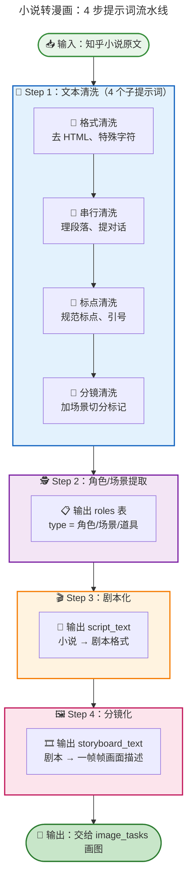
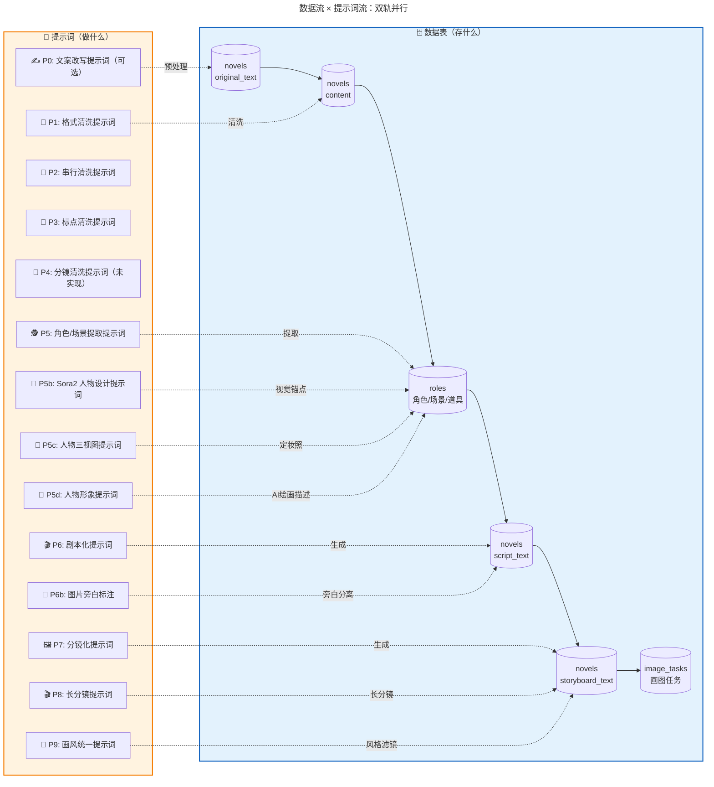
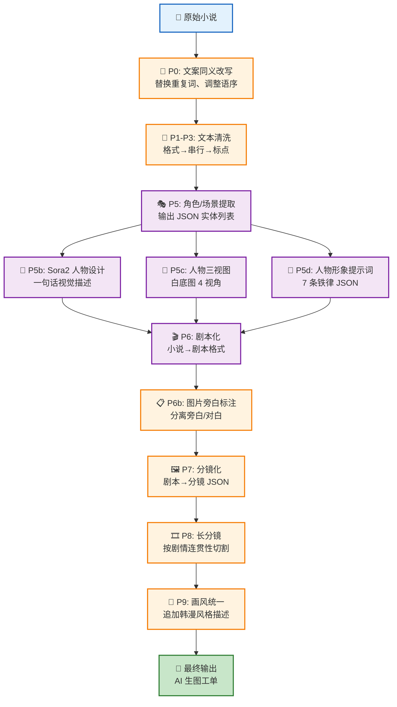

<!-- [AGC:FILE] tool=Cc author=fangkun date=2026-09-29 -->

# 大白话版：小说转漫画提示词汇总

> 核心理念：把"小说→漫画"这条链路上每一步该给 AI 说什么话，讲得明明白白

---

## 一、一句话说明白：这条链路到底在干嘛？

**小说转漫画 = 用 15 条提示词，把一坨文字，变成一帧帧能画出来的分镜。**

整条链路长这样：

```
知乎付费专栏 → 小说下载 → 文本清洗 → 角色/场景提取 → 分镜生成 → 图像生成
```

### 1.1 数据来源

- **主要平台**：知乎付费专栏（zhihu.com/market/paid_column）
- **辅助平台**：Lofter
- **内部系统**：Snowslide（雪崩）平台别名管理

### 1.2 类比理解

**🎬 类比图**：


**关键数据**（吹牛用）：
- 小说长度：5183 ~ 10120 字符
- 清洗步骤：4 步（格式→串行→标点→分镜）
- 数据表：novels、roles、scripts_list、image_tasks
- 当前已下载：3 部小说（《纪姑娘的爱给谁都盛大》《浣花溪上》《富门铁公鸡》）

---

## 二、系统架构（内嵌原文核心）

### 2.1 系统架构全景

```
┌─────────────────────────────────────────────────────────────────┐
│                         小说下载系统架构                          │
├─────────────────────────────────────────────────────────────────┤
│                                                                  │
│  用户输入                                                        │
│    ↓                                                            │
│  知乎付费专栏 URL                                                │
│    ↓                                                            │
│  ┌──────────────────────────────────────────────────────────┐  │
│  │  Snowslide 下载引擎                                      │  │
│  │  ├─ 账号认证（snowslide_account.json）                   │  │
│  │  ├─ 别名映射（snowslide_alias_success）                  │  │
│  │  └─ 内容抓取（知乎 API 或页面解析）                      │  │
│  └──────────────────────────────────────────────────────────┘  │
│    ↓                                                            │
│  novels 表                                                      │
│    ├─ share_url（原始链接）                                     │
│    ├─ original_text（原始文本）                                 │
│    └─ content（清洗后文本）                                     │
│    ↓                                                            │
│  ┌──────────────────────────────────────────────────────────┐  │
│  │  文本清洗流水线                                          │  │
│  │  ├─ 格式清洗（is_format_cleaned）                        │  │
│  │  ├─ 串行清洗（is_serial_cleaned）                        │  │
│  │  ├─ 标点清洗（is_punct_cleaned）                         │  │
│  │  └─ 分镜清洗（is_shot_cleaned）                          │  │
│  └──────────────────────────────────────────────────────────┘  │
│    ↓                                                            │
│  后续处理                                                       │
│    ├─ 角色提取 → roles 表                                       │
│    ├─ 场景识别 → roles 表（type=场景）                          │
│    ├─ 剧本生成 → script_text                                    │
│    └─ 分镜文本 → storyboard_text                                │
└─────────────────────────────────────────────────────────────────┘
```

### 2.2 核心数据表 novels

| 字段 | 说明 |
|------|------|
| `id` | 主键 |
| `name` | 小说名称 |
| `content` | 清洗后文本 |
| `original_text` | 原始下载文本 |
| `character_text` | 角色提取文本 |
| `script_text` | 剧本化文本 |
| `storyboard_text` | 分镜文本 |
| `share_url` | 知乎专栏链接 |
| `is_format_cleaned` | 格式清洗完成标记 |
| `is_serial_cleaned` | 串行清洗完成标记 |
| `is_punct_cleaned` | 标点清洗完成标记 |
| `is_shot_cleaned` | 分镜清洗完成标记 |

### 2.3 完整数据流转

```
知乎URL → snowslide_alias_last_url
    ↓
Snowslide下载 → snowslide_alias_success
    ↓
novels表
    ├─ original_text（原始）
    ├─ content（清洗后）
    ├─ character_text（角色提取）
    ├─ script_text（剧本化）
    └─ storyboard_text（分镜文本）
    ↓
projects表（关联小说）
    ↓
roles表（角色/场景/道具）
    ↓
scripts_list表（分镜列表）
    ↓
image_tasks表（图像生成任务）
```

---

## 三、核心流程总览：4 步提示词，串起整条链路

### 3.1 流程全景图



---

## 四、文本清洗流水线（内嵌原文核心）

### 4.1 清洗步骤总览

| 步骤 | 标记字段 | 说明 | 当前状态 |
|-----|---------|------|---------|
| 1 | is_format_cleaned | 格式清洗（去除HTML标签、特殊字符） | ✅ 全部完成 |
| 2 | is_serial_cleaned | 串行清洗（段落整理、对话提取） | ✅ 全部完成 |
| 3 | is_punct_cleaned | 标点清洗（标点规范化） | ✅ 全部完成 |
| 4 | is_shot_cleaned | 分镜清洗（分镜预处理） | ❌ 全部未完成 |

### 4.2 清洗流程图

```
original_text（原始文本）
    ↓
[格式清洗] is_format_cleaned = 1
    ├─ 去除HTML标签
    ├─ 去除特殊字符
    └─ 统一换行符
    ↓
[串行清洗] is_serial_cleaned = 1
    ├─ 段落整理
    ├─ 对话提取
    └─ 去除冗余空白
    ↓
[标点清洗] is_punct_cleaned = 1
    ├─ 标点规范化
    ├─ 引号统一
    └─ 省略号处理
    ↓
[分镜清洗] is_shot_cleaned = 0
    ├─ 分镜预处理（未实现）
    └─ 场景切分标记
    ↓
content（最终文本）
```

### 4.3 实际数据

| 小说ID | 名称 | 原始长度 | 清洗后长度 | 清洗率 |
|-------|------|---------|-----------|--------|
| 1 | 纪姑娘的爱给谁都盛大 | 10120 | 10120 | 100% |
| 4 | 浣花溪上 | 5252 | 5252 | 100% |
| 6 | 富门铁公鸡 | 5183 | 5183 | 100% |

**观察**：清洗后长度与原始长度相同，说明清洗是**原地修改**而非追加。

---

## 五、Step 1：文本清洗的 4 条提示词

**大白话**：小说刚抓下来是一坨带着 HTML 标签、乱码、奇怪换行的"脏文本"，得先让 AI 把它洗成干净的"可加工文本"。

### 5.1 提示词 1-1：格式清洗

| 项 | 内容 |
|---|---|
| **目标** | 去掉 HTML 标签、特殊字符、统一换行符 |
| **输入** | `original_text`（原始下载文本） |
| **输出** | 干净的纯文本 |
| **标记** | `is_format_cleaned = 1` |

**提示词骨架**：

```
你是一个文本清洗助手。请把下面这段从知乎抓下来的小说文本，
清理成干净的纯文本：

1. 删除所有 HTML 标签（<p>、<div>、<br> 等）
2. 删除特殊控制字符（\x00~\x1F）
3. 把 \r\n 统一成 \n
4. 保留中文、英文、数字、常见标点

不要改动正文内容，不要添加任何解释。

【原文】
{original_text}
```

### 5.2 提示词 1-2：串行清洗

| 项 | 内容 |
|---|---|
| **目标** | 整理段落、把对话从叙述中抽出来、去掉冗余空白 |
| **输入** | 格式清洗后的文本 |
| **输出** | 段落分明、对话独立的文本 |
| **标记** | `is_serial_cleaned = 1` |

**提示词骨架**：

```
你是一个小说编辑。请对下面这段文本做"串行清洗"：

1. 把连在一起的长段落，按叙事节奏拆成短段
2. 把对话（"xxx"）单独成段
3. 删除连续空行，只保留一个换行
4. 保留原文措辞，不要改写内容

【文本】
{format_cleaned_text}
```

### 5.3 提示词 1-3：标点清洗

| 项 | 内容 |
|---|---|
| **目标** | 统一标点（中文标点）、规范引号、处理省略号 |
| **输入** | 串行清洗后的文本 |
| **输出** | 标点规范的文本 |
| **标记** | `is_punct_cleaned = 1` |

**提示词骨架**：

```
你是一个校对编辑。请规范化下面小说文本的标点符号：

1. 英文标点 → 中文标点（, → ，, . → 。, ! → ！, ? → ？）
2. 引号统一为 ""「」或""""（选一种）
3. 省略号统一为 "……"（6 点）
4. 破折号统一为 "——"

【文本】
{serial_cleaned_text}
```

### 5.4 提示词 1-4：分镜清洗（⚠️ 未实现）

| 项 | 内容 |
|---|---|
| **目标** | 在文本里加"场景切分标记"，为后续分镜做准备 |
| **输入** | 标点清洗后的文本 |
| **输出** | 带场景切分标记的文本 |
| **标记** | `is_shot_cleaned = 1` |
| **状态** | ❌ 设计文档明确说：**全部未完成** |

**提示词骨架**（推演版）：

```
你是一个分镜师。请阅读下面这段小说，在"场景切换"的地方插入标记：

场景切换的判断标准：
- 地点变了（从客厅→街道）
- 时间变了（从白天→夜晚）
- 视角人物变了

在每次切换处插入一行：
---SCENE_BREAK---

不要改动正文内容。

【文本】
{punct_cleaned_text}
```

---

## 六、Step 2：角色 / 场景提取提示词

**大白话**：洗干净的文本里，到底有哪些人物？哪些场景？哪些关键道具？这一步要让 AI 当"选角导演"，列出一份清单。

### 6.1 提示词 2：角色/场景/道具提取

| 项 | 内容 |
|---|---|
| **目标** | 从文本中抽出"角色、场景、道具"三类实体 |
| **输入** | `content`（清洗后文本） |
| **输出** | `character_text`（角色提取文本） |
| **落库** | `roles` 表（type = 角色 / 场景 / 道具） |

**提示词骨架**：

```
你是一个小说选角导演。请阅读下面这段小说，
按 JSON 格式列出所有出现的"角色 / 场景 / 道具"。

每个实体包含：
- name：名字（角色名 / 场景名 / 道具名）
- type：角色 | 场景 | 道具
- appearance：第一次出场的段落编号
- description：一句话外貌/特征描述（用于后续画图）
- traits：性格/风格标签（角色专用，如"冷峻、多金"）

输出格式：
[
  {"name": "xxx", "type": "角色", "appearance": 1, "description": "...", "traits": ["...", "..."]},
  {"name": "xxx", "type": "场景", "appearance": 2, "description": "..."},
  {"name": "xxx", "type": "道具", "appearance": 3, "description": "..."}
]

只输出 JSON，不要解释。

【小说】
{content}
```

### 6.2 提示词 2-2：Sora2 视频人物设计（角色视觉化）

| 项 | 内容 |
|---|---|
| **目标** | 把小说里的人物，转成 Sora2 视频生成能直接用的"一句话视觉描述" |
| **输入** | `character_text`（角色清单） + 小说原文上下文 |
| **输出** | 每个角色一段"姓名/身份 + 一句话外貌描述" |
| **用途** | 作为后续所有分镜帧的**角色视觉锚点**，保证同一角色跨帧不"变脸" |

**提示词骨架**：

````
# 角色
你是一位经验丰富的 Sora2 视频人物设计大师。

一句话描述角色信息，必须包含以下视觉维度（用自然语言串成一句，不要列点）：

年龄 / 外观 / 身高 / 身材 / 肤色 / 脸型 / 眼睛 / 瞳色 / 眉形 / 发型 / 发色 / 发饰 / 服装主色 / 上衣 / 下衣 / 鞋子 / 服装描述 / 标志性小物件 / 姿态 / 表情 / 灯光

要求：
- 小说人物必须个性鲜明，一眼能认出来
- 描述必须"一句话"完成（逗号分隔，不要换行）
- 直接给我结果，不需要其他描述

按照下面案例的格式，给我人物角色信息：

【案例】

冯季宣/哥哥
一位年轻男性，身高约182厘米，体型修长挺拔，面容俊朗英气，剑眉入鬓，眼睛炯炯有神，琥珀色瞳孔透着一股急躁与难以置信，鼻梁高挺，嘴唇略薄，表情丰富多变，常处于震惊和抓狂的状态。头发为黑色长发，头顶束发戴着精致的金冠，其余发丝自然垂落。身着金黄色的广袖汉服长袍，衣料上有暗纹装饰，显得贵气逼人，整体气质虽然尊贵但此刻显得十分焦灼。

秦知月/嫂嫂
一位中年男性，身高约178厘米，体型端正稳重，国字脸，神情从容淡定，留着修剪整齐的黑色八字胡和下颌短须，眼神深邃且带着一丝不易察觉的狡黠或调侃，黑色瞳孔。头戴黑色的古代官帽（嵌有绿宝石），身着深绿色的圆领官服，腰束革带，整体给人一种老谋深算、处变不惊的朝廷命官形象。

【小说角色清单】
{character_text}

【小说原文（用于把握气质/场景/服装风格）】
{content}
````

**输出示例**（基于《富门铁公鸡》推演）：

```
富门少爷/男主
一位年轻男性，身高约180厘米，体型清瘦挺拔，面容俊秀带几分傲气，剑眉星目，黑色瞳孔透着精明与倔强，鼻梁高挺，薄唇紧抿，神情介于倨傲与窘迫之间。头发乌黑束冠，身着暗红色织金锦袍，腰束白玉带，脚踏黑色云头履，手持一把折扇（标志性小物件），整体气质贵气但带着一丝"落难公子"的落魄感。

账房先生/配角
一位中年男性，身高约170厘米，体型微胖圆润，圆脸笑眼，八字胡修剪整齐，棕色瞳孔透着算计与世故，肤色偏白。头发花白束简单发髻，身着土黄色棉布长衫，外罩深褐色马甲，腰挂一把小算盘（标志性小物件），脚踏黑色布鞋，整体给人一种"精明抠门"的市井气息。
```

### 6.3 提示词 2-3：人物角色三视图（角色定妆照）

| 项 | 内容 |
|---|---|
| **目标** | 生成角色的"定妆照"：一张图包含 4 个视角，确保角色在后续所有分镜中视觉一致 |
| **输入** | Sora2 人物描述（6.2 的输出） |
| **输出** | 一张白底图，包含：左边近景正面胸像 + 右边三视图（正面全身、侧面全身、背面全身） |
| **用途** | 作为角色视觉锚点的"参考图"，AI 生图时用来保持角色一致性 |

**提示词骨架**：

````
Generate a character reference sheet for AI image generation.

Layout requirements:
- Left side: Close-up chest portrait (front view, showing face and upper body details)
- Right side: Full-body three-view diagram with exactly 4 poses:
  1. Front view (full body)
  2. Side view (full body, profile)
  3. Back view (full body)

Critical rules:
- Pure white background (#FFFFFF)
- NO text labels or annotations
- NO dividing lines between views
- NO borders or frames
- Keep consistent lighting (soft, even studio lighting)
- Maintain exact same character appearance across all 4 views:
  * Same face, hairstyle, hair color
  * Same outfit, colors, accessories
  * Same body proportions and build

Character description:
{character_visual_description}

Output: Single image, 4 views arranged as described, white background, no text, no lines.
````

**中文版本**（适用于通义万相、可灵等国内工具）：

````
生成一张角色参考图，用于 AI 图像生成。

布局要求：
- 左侧：近景正面胸像（展示面部和上半身细节）
- 右侧：全身三视图，共 4 个姿态：
  1. 正面全身
  2. 侧面全身（侧脸轮廓）
  3. 背面全身

关键规则：
- 纯白色背景（#FFFFFF）
- 不要任何文字标注或注释
- 不要视图之间的分割线
- 不要边框
- 保持统一的光线（柔和、均匀的工作室光）
- 4 个视图中的角色外观必须完全一致：
  * 相同的脸型、发型、发色
  * 相同的服装、颜色、配饰
  * 相同的身体比例和体型

角色描述：
{角色视觉描述}

输出：单张图片，4 个视图按上述布局排列，白底，无文字，无线条。
````

**使用建议**：

1. **配合 6.2 使用**：先用 6.2 生成"一句话视觉描述"，再用 6.3 生成参考图
2. **跨帧一致性**：后续生成分镜时，把这张参考图作为 `image_reference` 参数传入
3. **多角色管理**：每个主要角色都生成一张三视图，建立"角色视觉库"

### 6.4 提示词 2-4：人物形象提示词（AI绘画专用）

| 项 | 内容 |
|---|---|
| **目标** | 从小说内容自动推导所有角色的外貌特征，生成适合 AI 生图的高质量视觉描述 |
| **输入** | `content`（小说原文） |
| **输出** | JSON 数组，每个角色一个条目：`{"name": "角色名", "content": "视觉描述段落"}` |
| **特点** | 比 P5b 更严格：逗号分隔流、禁止手持物品、支持年龄段变体拆分 |

**核心约束**（7 条铁律）：

1. **首句融合规则**：必须以 `一个[年龄]的[时代/风格][身份/性别]` 格式开头
2. **逗号分隔流**：全文逗号分隔，**严禁**出现"发型:"、"服装:"等前缀标签
3. **拒绝抽象，强制细节**：必须脑补具体款式、材质、设计点（如"米白色老花纹小香风长袖上衣"）
4. **纯净体态**：**严禁**描写人物手持任何物品（不拿扇子、不拿剑、不看手机）
5. **五官与妆造**：必须描述脸型、眼型、具体妆容感（如"浅番茄色唇"）
6. **拒绝随机**：**绝对不可**出现"随机"二字
7. **年龄段变体拆分**：同一角色跨越不同人生阶段时，必须拆分为多个独立 JSON 条目

**提示词骨架**：

````
# Role
你是一位精通 AI 绘画提示词撰写与人物视觉设计的审美大师。

# Task
请根据用户提供的小说内容，自动推导小说所有角色的外貌特征，并进行极具画面感的**细节填充**（如具体的服装款式、材质、配饰细节），生成一份适合 AI 生图的高质量视觉描述。

# Logic Constraints (核心逻辑)
1. **首句融合规则**：描述的第一句必须严格按照 `一个[年龄]的[时代/风格][身份/性别]` 格式开头（例如:"一个24岁的现代年轻女性"）。
2. **逗号分隔流**：全文采用**逗号分隔**的短语形式，**严禁**出现"发型:"、"服装:"等前缀标签。
3. **拒绝抽象，强制细节**：
   - 如果是"好看的衣服"，必须脑补为具体的款式（如"米白色老花纹小香风长袖上衣"）。
   - 必须包含具体的材质、设计点（如"麂皮"、"流苏"、"金属纽扣"）。
4. **纯净体态（重要）**：为了适配各种视频场景，**严禁描写人物手持任何物品**（不要写拿扇子、拿剑、看手机等），仅描写自然站立或静态特征。
5. **五官与妆造**：必须描述脸型、眼型、具体妆容感（如"浅番茄色唇"、"精致妆容"）。
6. **拒绝随机**：文中**绝对不可出现"随机"二字**，所有细节必须根据角色人设进行合理推导。
7. **年龄段变体拆分（重要）**：
   - **触发条件**：当同一角色在小说中跨越不同人生阶段，且各阶段外貌存在显著差异时（如从少年成长到成年，或从成年步入老年），必须触发拆分。若小说中该角色仅在单一年龄段出现，或未明确描述外貌变化，则**只生成一个条目**。
   - **拆分方式**：将同一角色拆分为**多个独立的 JSON 条目**输出（不可合并为一条），每个条目代表该角色在特定年龄段的完整视觉形象。
   - **命名规则**：条目名称格式为 `[角色名][年龄段]`，年龄段统一从以下七个标准词中选取：**婴儿、幼儿、少年、青年、成年、中年、老年**。示例："苏晚少年"、"苏晚成年"、"李明中年"。
   - **每条独立完整**：每个年龄段条目的 `content` 必须是该年龄段完整、独立的视觉描述，不可出现"与少年期相似"等引用其他条目的表述。

# Output Format (输出格式)
**必须严格按照以下 JSON 格式返回结果（不要包含 markdown 代码块，不要有任何额外解释）：**

[{"name": "角色名", "content": "视觉描述段落"}, ...]

**视觉描述段落格式**：
[年龄+时代+身份融合句], [肤色/颜值评价], [脸型/五官细节], [具体的妆容描述], [具体发色/发型/发丝动态], [详细的服装款式/颜色/材质/设计细节], [配饰/氛围感]

# Examples (示例)

[
  {
    "name": "苏晚少年",
    "content": "一个12岁的现代清秀少女, 天生冷白皮, 干净通透带有孩童独有的细腻光泽, 鹅蛋脸初见雏形, 圆圆的杏眼清澈明亮, 素面朝天干净纯净, 乌发自然柔顺, 深棕色的眼眸像浸在水里的琥珀, 身穿淡色系棉质短袖连衣裙, 领口系着细长的蝴蝶结, 整体自带温柔纯真的气质"
  },
  {
    "name": "苏晚成年",
    "content": "一个24岁的现代年轻女性, 肤白貌美, 御姐脸, 鹅蛋脸型, 圆圆的杏眼, 绝美眼睛, 五官精致立体, 精致妆容, 黑棕色长发微卷自然垂落, 深棕色眼睛, 浅番茄色唇, 冷白皮, 身穿着米白色老花纹小香风长袖上衣, 前面有三颗金属纽扣, 下身穿深咖色麂皮短裙下摆流苏设计, 脖子系黑白条纹丝巾, 珍珠耳钉"
  },
  {
    "name": "谢楠",
    "content": "一个19岁的现代校园帅哥, 冷白皮, 纯情少年感, 棱角分明的脸部轮廓, 瑞凤眼, 眼神清澈内敛, 干净少年感裸妆, 黑色碎盖短发干净利落, 几缕发丝垂在眉间, 身穿深藏青色DK制服西装, 内搭雪白挺括衬衫, 佩戴极简银色细手链, 甚至能看到手背青筋, 整体气质清冷孤傲"
  },
  {
    "name": "柳如是",
    "content": "一个20岁的古代明风绝美才女, 肤如凝脂, 面若桃花, 瓜子脸, 柳叶眉, 眼波流转含情, 古典淡雅妆容, 点绛唇, 乌黑长发盘起精致云髻, 发带随风轻扬, 身穿淡青色立领对襟丝绸长衫, 下着马面裙绣有兰花暗纹, 领口镶嵌珍珠扣, 双手自然垂落, 气质清冷高贵"
  }
]

# Initialization
请直接开始分析，结果不需要任何解释，直接输出 JSON 格式结果。

小说内容：
{content}
````

**与 P5b 的对比**：

| 维度 | P5b（Sora2 人物设计） | P5d（人物形象提示词） |
|------|---------------------|---------------------|
| **输出格式** | 一句话自然语言描述 | JSON 数组（name + content） |
| **年龄段拆分** | ❌ 不支持 | ✅ 支持（苏晚少年/苏晚成年） |
| **约束严格度** | 中等（21 个维度） | 严格（7 条铁律） |
| **适用场景** | Sora2 视频生成 | AI 绘画（Midjourney/Stable Diffusion） |
| **细节强制** | 可选 | 强制（禁止抽象、禁止手持物品） |

**使用建议**：
- ✅ 需要精确控制每个角色的视觉细节 → 用 P5d
- ✅ 同一角色有多个年龄段形象 → 用 P5d
- ✅ 生成 AI 绘画提示词（Midjourney/SD） → 用 P5d
- ✅ 快速生成视频角色描述 → 用 P5b

---

## 七、Step 3：剧本化提示词

**大白话**：小说是叙述体，漫画是画面体。这一步让 AI 把"他心想……"改成"特写：他眉头紧皱"——从文字思维切换到画面思维。

### 7.1 提示词 3：小说 → 剧本

| 项      | 内容                                        |
| ------ | ----------------------------------------- |
| **目标** | 把小说文本改成剧本格式（场景 + 角色 + 动作 + 台词）            |
| **输入** | `content`（清洗后文本） + `character_text`（角色清单） |
| **输出** | `script_text`                             |

**提示词骨架**：

```
你是一个漫画编剧。请把下面这段小说改写成剧本格式。

剧本格式要求：
每场戏包含：
- SCENE N：场景编号
- LOCATION：地点（从 roles 表的"场景"里选）
- TIME：白天 / 夜晚 / 黄昏
- CHARACTERS：出场角色（从 roles 表的"角色"里选）
- ACTION：角色的动作、表情、镜头指示
- DIALOGUE：角色台词，格式为 "角色名：台词"

改写原则：
1. 心理描写 → 转成表情/动作
2. 叙述性描写 → 转成镜头指示（如"特写""远景"）
3. 保留关键台词
4. 每场戏控制在 3~8 个画面

【角色清单】
{character_text}

【小说】
{content}
```

### 7.2 图片旁白提示词：分离旁白与对白

**大白话**：剧本里混着旁白和角色台词，需要把它们分开，方便后续配音、加字幕或做分镜。

**提示词骨架**：

````
# 角色
你对阅读小说和阅读剧本拥有非常兴趣的爱好，并且拥有了十年经验的阅读经历，所以任何一个文案在你面前，你只需要看一眼，你就可以分辨出哪个地方属于角色对话内容或者是旁白内容。

# 任务
我会向你提供一段小说或剧本正文（可能混排旁白与对白）。你要做的是在**不改动原文用字、不删减、不扩写**的前提下，把它整理成「旁白」与「角色对白」分块输出。

## 输出要求
1. 严格按原文顺序输出；禁止总结剧情、禁止解释推理过程。
2. 使用下列标签之一作为每行行首（或每段行首）：
   - 【旁白】后接原文中的叙述/描写/心理活动等非角色开口台词。
   - 【角色名对白】后接该角色说出或引号内的台词；角色名从上下文合理推断，原文已写「某某说」则沿用该名称。
3. 原文中的引号、标点保持原样；若连续多句同属一人对白，可合并为同一块，但仍须逐字来自原文。
4. 不要输出 Markdown 代码围栏以外的开场白或结束语。

## 待处理正文
{content}
````

**用途**：
- 为后续配音提供清晰的角色台词列表
- 为分镜标注哪些画面配旁白、哪些配对白气泡
- 为字幕生成提供结构化输入

---

## 八、Step 4：分镜化提示词

**大白话**：剧本还是一整场一整场的，漫画是一格一格的。这一步让 AI 把每场戏拆成一帧帧"分镜描述"，每一帧就是未来 AI 画图的一条 prompt。

### 8.1 提示词 4：剧本 → 分镜

| 项 | 内容 |
|---|---|
| **目标** | 把剧本拆成"一帧帧"的画面描述 |
| **输入** | `script_text` |
| **输出** | `storyboard_text`（《富门铁公鸡》的 storyboard_text 是 5244 字符） |
| **落库** | `scripts_list` 表 → `image_tasks` 表 |

**提示词骨架**：

```
你是一个漫画分镜师。请把下面这段剧本，拆成一帧帧的分镜。

每帧分镜包含：
- frame_id：帧编号（1, 2, 3...）
- scene_id：所属场景
- shot_type：景别（远景 / 中景 / 近景 / 特写）
- camera：镜头（俯视 / 平视 / 仰视）
- characters：出场角色 + 表情 + 姿势
- location：地点
- props：关键道具
- action：正在发生的动作
- dialogue：这一帧的台词（没有就空）
- emotion：画面氛围（温馨 / 紧张 / 搞笑...）
- image_prompt：给 AI 画图的英文提示词（一句话，含角色外貌、服装、动作、背景、光影）

输出格式：JSON 数组。

【角色外貌参考（保证画风一致）】
{character_text}

【剧本】
{script_text}
```

### 8.2 提示词 8-2：长分镜提示词（降低切割频率）

**大白话**：有时候文本很长，需要按故事剧情、人物对白、场景变化来分割分镜，而不是机械地按字数切。这个提示词让 AI 像电影分镜师一样，把相关的内容合并成一个分镜，降低切割频率。

**提示词骨架**：

````
你现在是一名世界级的电影分镜设计师，请逐句分析我给你的文本后，按故事剧情，人物对白、主体人物等元素将文本分割成一系列连贯的分镜头，每个分镜头内的人物和场景必须保持一致，必须将上下文中内容有关联的文本合并为一个分镜，并联系上下文后将说话的人和说话的内容合并，必须降低分镜的切割频率。最终输出为编号加文本的形式，每一个分镜结束后改成句号结束，其他文本后的符号改成逗号，严禁对文本信息进行修改，原文本内容不能删减，不要描述原因，按编号连续输出，不要间断，一直执行到所有文本结束，每个分镜内的句子控制在30个字以内。

## Examples

文本：
在一个风雨交加的夜晚，
侦探走进了昏暗的酒吧，
吧台后的酒保抬头看了他一眼，
又继续擦拭手中的玻璃杯。
"唉，又要死一个......"
酒保内心默默叹口气。
"不过，遇见仇人可是分外眼红呀。"
你低声喃喃自语道。

输出：
1. 在一个风雨交加的夜晚，侦探走进了昏暗的酒吧。
2. 吧台后的酒保抬头看了他一眼,又继续擦拭手中的玻璃杯，唉，又要死一个，酒保内心默默叹口气。
3. 不过，遇见仇人可是分外眼红呀，你低声喃喃自语道。

## Initialization

如果因为篇幅限制，一次出50个分镜，在我输入继续后，出下一部分的50个分镜，按对应编号连续输出，不要间断，一直执行到所有文本结束后停止。

如果你明白，请回复：好的，长句版本

## 待处理文本
{content}
````

**用途**：
- 长文本的批量分镜处理
- 需要保持场景连贯性的分镜
- 人物对白和动作需要合并的分镜
- 降低分镜切割频率，提高画面连贯性

**关键特点**：
- ✅ 每个分镜内的人物和场景必须保持一致
- ✅ 将说话的人和说话的内容合并
- ✅ 降低分镜切割频率
- ✅ 每个分镜内的句子控制在30个字以内
- ✅ 支持分批输出（每次50个分镜）

### 8.3 提示词 8-3：画风统一提示词（韩漫风格）

| 项 | 内容 |
|---|---|
| **目标** | 确保所有分镜帧的画风统一，形成"顶级韩漫"视觉效果 |
| **输入** | 分镜化输出的 `image_prompt` |
| **输出** | 在每条 image_prompt 末尾追加画风描述 |
| **用途** | 作为分镜生图的"全局风格滤镜"，保证整部漫画视觉一致 |

**提示词骨架**：

````
# 画风定义

顶级韩漫风格，融合精致日系2D插画美学，精细线稿，柔和色彩，电影级光影，高对比度。

# 风格关键词

style: premium Korean manhwa, refined Japanese 2D illustration, delicate linework, soft pastel colors, cinematic lighting, high contrast, detailed shading, smooth gradients

# 使用方式

在每条分镜的 image_prompt 末尾追加：

, premium Korean manhwa style, refined Japanese 2D illustration, delicate linework, soft pastel colors, cinematic lighting, high contrast, detailed shading, smooth gradients, masterpiece quality, 8k resolution

# 示例

原始 image_prompt:
"A young man in red robe holding a fan, looking worried, standing in a luxurious room"

追加画风后:
"A young man in red robe holding a fan, looking worried, standing in a luxurious room, premium Korean manhwa style, refined Japanese 2D illustration, delicate linework, soft pastel colors, cinematic lighting, high contrast, detailed shading, smooth gradients, masterpiece quality, 8k resolution"
````

**适用场景**：
- 所有分镜帧的 AI 生图
- 角色三视图生成（6.3）
- 封面图、宣传图生成

---

## 八点五、Step 0：文案预处理（可选）

**大白话**：有时候拿到的小说文本质量不好（用词重复、语病多、读起来拗口），得先让 AI 做一轮"同义改写"，把文本打磨光滑，再进入清洗流水线。

### 0.1 提示词 0：文案同义改写

| 项      | 内容                                      |
| ------ | --------------------------------------- |
| **目标** | 在**完全保持原意与剧情信息**的前提下，替换重复用词、调整语序，让阅读更顺畅 |
| **输入** | 小说片段（原始文本）                              |
| **输出** | 改写后的完整正文（一段到底）                          |
| **约束** | 严禁增删情节、严禁改变人物关系/时间线/因果                  |

**提示词骨架**：

````
# 角色 (Role)
你是一位专业的小说文案编辑、同义改写专家、文本润色师与校对员。

# 核心任务 (Core Task)
你的核心任务是，在**完全保持原意与剧情信息**的前提下，对用户提供的正文进行同义改写与润色：替换重复用词、调整语序与句式使阅读更顺畅，**严禁增删情节、严禁改变人物关系、时间线与因果**。

# 工作原则
1. 逐句对照原文，改写后信息量与原文等价，不得凭空添加设定。
2. 人名、地名、称谓、数字及专有名词保持原样；口语可适度书面化，但不要「翻译腔」堆砌。
3. 不要输出点评、提纲、思维过程；不要包裹在 Markdown 代码块中。

# 输出格式
直接输出改写后的**完整正文**一段到底，不要额外小标题。

# 待改写正文
（将正文粘贴于下）

{original_text}
````

**使用场景**：
- 知乎抓取的文本质量参差不齐时
- 对话过于口语化、需要适度书面化时
- 用词重复严重（如"他看了看她，她又看了看他"）时

**注意事项**：
- ⚠️ 这一步是**可选的**，如果原文质量已经很好，可以跳过
- ⚠️ 改写后务必人工抽查，确保没有"AI味"过重
- ⚠️ 专有名词（人名、地名）必须保持原样

---

## 九、可视化总览：数据 + 提示词双轨流转



---

## 十、小说数据完整性

| 字段 | 小说1 | 小说4 | 小说6 |
|-----|------|------|------|
| content | ✅ 10120 | ✅ 5252 | ✅ 5183 |
| original_text | ✅ 10120 | ✅ 5252 | ✅ 5183 |
| character_text | ❌ 0 | ✅ 5043 | ❌ 0 |
| script_text | ❌ 0 | ❌ 0 | ❌ 0 |
| storyboard_text | ❌ 0 | ✅ 5043 | ✅ 5244 |
| share_url | ✅ | ✅ | ✅ |

**说明**：不同小说的处理进度不同，部分已完成角色提取和分镜生成。

---

## 十一、关键数字速记

```
┌────────────────────────────────────────────────────────┐
│  📊 关键数字（吹牛用）                                 │
├────────────────────────────────────────────────────────┤
│  • 3 部：当前已下载的小说数量（ID: 1, 4, 6）          │
│  • 5183~10120：小说字符长度范围                        │
│  • 4 步清洗：格式→串行→标点→分镜（最后一步未做）      │
│  • 4 张核心表：novels / roles / scripts_list / image_tasks │
│  • 5244 字符：《富门铁公鸡》分镜文本长度               │
│  • 3 层安全：PyArmor + Fernet + 设备绑定               │
└────────────────────────────────────────────────────────┘
```

---

## 十二、类比速记卡

| 概念            | 类比                    | 说明                      |
| ------------- | --------------------- | ----------------------- |
| 文本清洗 4 步      | 洗菜 → 切菜 → 焯水 → 摆盘     | 逐步从粗到精处理原材料             |
| 角色/场景提取       | 选角导演看剧本，列演员表          | 从故事中提取所有实体              |
| Sora2 人物设计    | 给每个角色拍一张"定妆照"         | 输出一句话视觉描述，作为跨帧视觉锚点      |
| 人物三视图         | 角色的"身份证照片"            | 一张图 4 个视角，确保 AI 画图不"变脸" |
| 人物形象提示词       | 给每个角色写"AI绘画说明书"       | JSON 格式、7 条铁律、支持年龄段拆分   |
| 文案同义改写        | 把"粗糙的原石"打磨成"光滑的玉"     | 替换重复用词、调整语序，不改变剧情       |
| 画风统一          | 给所有分镜加上"韩漫滤镜"         | 保证整部漫画视觉风格一致            |
| 剧本化           | 把"小说版"改成"剧本版"         | 从叙述体切换到画面体              |
| 图片旁白标注        | 把"混在一起的台词"拆成"旁白"和"对白" | 为配音、字幕、分镜提供结构化输入        |
| 长分镜提示词        | 把"长文本"按剧情连贯性拆成"分镜头"   | 降低切割频率，保持场景连贯性          |
| 分镜化           | 把"一场戏"切成"一格一格"        | 每格就是 AI 画图的一条工单         |
| novels 表      | 整条流水线的"主台账"           | 记录每部小说的所有状态             |
| roles 表       | 演员 + 场景 + 道具清单        | 保证画风一致性的关键              |
| image_tasks 表 | 画师手上的"工单"             | 每帧画面一个任务                |

---

## 十三、完整流程演示（以《姐妹和离记》为例）

> 用一段简化的小说内容，完整走一遍 15 条提示词的处理流程，展示每个环节的输出样例。

### 流程总览图



### 13.1 原始小说片段

```
我自小没主见。事事都以阿姐为主。阿姐梳单螺髻好看，我便也梳个一样的。
阿姐及笄后，嫁进崔家。我及笄后，实在选不出嫁谁才好。便也跟着阿姐一起嫁进崔家。
她嫁给大公子崔珩，我便嫁给二公子崔珏。
可婚后没多久，崔家来了个远房表妹。她体弱多病，身世可怜。
阿姐却常会因她与崔珩吵得面红耳赤。
直到崔珩又一次因表妹弃阿姐而去。阿姐疲惫地靠在榻上：以宁，我想与崔珩和离。
我毫不犹豫开口：那我也离！
```

---

### 13.2 P0：文案同义改写（预处理）

#### 📋 提示词模板

```
# 角色
你是一位专业的小说文案编辑、同义改写专家。

# 任务
在保持原意的前提下，替换重复用词、调整语序，让阅读更顺畅。

# 约束
- 严禁增删情节
- 严禁改变人物关系、时间线、因果
- 人名、地名保持原样

# 待改写正文
{content}
```

#### 📥 输入数据

```
我自小没主见。事事都以阿姐为主。阿姐梳单螺髻好看，我便也梳个一样的。
阿姐及笄后，嫁进崔家。我及笄后，实在选不出嫁谁才好。便也跟着阿姐一起嫁进崔家。
她嫁给大公子崔珩，我便嫁给二公子崔珏。
可婚后没多久，崔家来了个远房表妹。她体弱多病，身世可怜。
阿姐却常会因她与崔珩吵得面红耳赤。
直到崔珩又一次因表妹弃阿姐而去。阿姐疲惫地靠在榻上：以宁，我想与崔珩和离。
我毫不犹豫开口：那我也离！
```

#### 📤 输出结果

```
我自幼缺乏主见，凡事都依从阿姐。阿姐梳单螺髻好看，我便也梳同样的发式。
阿姐及笄之年嫁入崔家。我到了及笄年纪，实在选不出合适的人家，便也跟着阿姐嫁进崔府。
她嫁给大公子崔珩，我便嫁给二公子崔珏。
谁知婚后不久，崔家来了一位远房表妹。她体弱多病，身世堪怜。
阿姐却常因她与崔珩吵得不可开交。
直到崔珩又一次因表妹抛下阿姐离去。阿姐疲惫地倚在榻上：以宁，我想与崔珩和离。
我不假思索地开口：那我也离！
```

---

### 13.3 P1-P3：文本清洗（格式/串行/标点）

#### 📋 提示词模板（P1 格式清洗）

```
你是一个文本清洗助手。请把下面这段文本清理成干净的纯文本：

1. 删除所有 HTML 标签
2. 删除特殊控制字符
3. 统一换行符为 \n
4. 保留中文、英文、数字、常见标点

【原文】
{original_text}
```

#### 📋 提示词模板（P2 串行清洗）

```
你是一个小说编辑。请对下面这段文本做"串行清洗"：

1. 把长段落按叙事节奏拆成短段
2. 把对话单独成段
3. 删除连续空行
4. 保留原文措辞

【文本】
{format_cleaned_text}
```

#### 📋 提示词模板（P3 标点清洗）

```
你是一个校对编辑。请规范化下面小说文本的标点符号：

1. 英文标点 → 中文标点
2. 引号统一为 ""
3. 省略号统一为 "……"
4. 破折号统一为 "——"

【文本】
{serial_cleaned_text}
```

#### 📥 输入数据

P1-P3 依次处理 13.2 的输出

#### 📤 输出结果

```
我自幼缺乏主见，凡事都依从阿姐。阿姐梳单螺髻好看，我便也梳同样的发式。
阿姐及笄之年嫁入崔家。我到了及笄年纪，实在选不出合适的人家，便也跟着阿姐嫁进崔府。
她嫁给大公子崔珩，我便嫁给二公子崔珏。
谁知婚后不久，崔家来了一位远房表妹。她体弱多病，身世堪怜。
阿姐却常因她与崔珩吵得不可开交。
直到崔珩又一次因表妹抛下阿姐离去。阿姐疲惫地倚在榻上："以宁，我想与崔珩和离。"
我不假思索地开口："那我也离！"
```

---

### 13.4 P5：角色/场景提取

#### 📋 提示词模板

```
你是一个小说选角导演。请阅读下面这段小说，
按 JSON 格式列出所有出现的"角色 / 场景 / 道具"。

每个实体包含：
- name：名字
- type：角色 | 场景 | 道具
- appearance：第一次出场的段落编号
- description：一句话描述
- traits：性格/风格标签（角色专用）

输出格式：
[
  {"name": "xxx", "type": "角色", "appearance": 1, "description": "...", "traits": ["..."]},
  {"name": "xxx", "type": "场景", "appearance": 2, "description": "..."}
]

只输出 JSON，不要解释。

【小说】
{content}
```

#### 📥 输入数据

P5 的输入 = 13.3 的清洗后文本

#### 📤 输出结果

```json
[
  {"name": "以宁", "type": "角色", "appearance": 1, "description": "阿姐的妹妹，缺乏主见，事事以阿姐为主", "traits": ["温柔", "依赖阿姐", "忠诚"]},
  {"name": "以清", "type": "角色", "appearance": 1, "description": "阿姐，崔珩之妻，大公子夫人", "traits": ["有主见", "坚强", "隐忍"]},
  {"name": "崔珩", "type": "角色", "appearance": 3, "description": "崔家大公子，以清的夫君", "traits": ["优柔寡断", "偏袒表妹"]},
  {"name": "崔珏", "type": "角色", "appearance": 3, "description": "崔家二公子，以宁的夫君", "traits": ["温和", "明事理"]},
  {"name": "林思婉", "type": "角色", "appearance": 4, "description": "崔家远房表妹，体弱多病", "traits": ["柔弱", "心机", "身世堪怜"]},
  {"name": "崔府正房", "type": "场景", "appearance": 6, "description": "阿姐倚榻说话的房间"}
]
```

---

### 13.5 P5b：Sora2 人物设计

#### 📋 提示词模板

```
# 角色
你是一位经验丰富的 Sora2 视频人物设计大师。

一句话描述角色信息，必须包含以下视觉维度（用自然语言串成一句）：

年龄 / 外观 / 身高 / 身材 / 肤色 / 脸型 / 眼睛 / 瞳色 / 眉形 / 发型 / 发色 / 发饰 / 服装主色 / 上衣 / 下衣 / 鞋子 / 服装描述 / 标志性小物件 / 姿态 / 表情 / 灯光

要求：
- 小说人物必须个性鲜明
- 描述必须"一句话"完成（逗号分隔）
- 直接给我结果，不需要其他描述

【案例】

冯季宣/哥哥
一位年轻男性，身高约182厘米，体型修长挺拔，面容俊朗英气，剑眉入鬓，眼睛炯炯有神，琥珀色瞳孔透着一股急躁与难以置信，鼻梁高挺，嘴唇略薄，表情丰富多变，常处于震惊和抓狂的状态。头发为黑色长发，头顶束发戴着精致的金冠，其余发丝自然垂落。身着金黄色的广袖汉服长袍，衣料上有暗纹装饰，显得贵气逼人，整体气质虽然尊贵但此刻显得十分焦灼。

【小说角色清单】
{character_text}

【小说原文（用于把握气质/场景/服装风格）】
{content}
```

#### 📥 输入数据

- `character_text` = 13.4 的角色清单
- `content` = 13.3 的清洗后文本

#### 📤 输出结果

```
以宁/妹妹
一位年轻女性，身高约165厘米，体型纤细柔美，面容清秀温婉，鹅蛋脸型，柳叶眉，杏眼含情，黑色瞳孔透着温柔与依赖，鼻梁秀挺，唇色淡粉，表情柔和顺从。头发乌黑如墨，梳着与阿姐相同的单螺髻，发丝柔顺贴服。身着淡青色交领襦裙，裙摆绣有浅蓝色兰花暗纹，腰束白色丝带，整体气质温婉可人，透着几分天真烂漫。

以清/阿姐
一位年轻女性，身高约168厘米，体型修长端庄，面容明艳大气，瓜子脸型，剑眉星目，黑色瞳孔透着坚韧与疲惫，鼻梁高挺，唇色玫红，神情间带着几分倦意。头发乌黑浓密，梳着精致的单螺髻，发髻上点缀珍珠发饰。身着深红色对襟长衫，衣料上有暗纹刺绣，腰束金色革带，整体气质端庄持重，却掩不住眉间的忧虑。

崔珩/大公子
一位年轻男性，身高约180厘米，体型修长俊朗，面容英挺，剑眉入鬓，眼睛深邃，黑色瞳孔透着优柔与不耐，鼻梁高挺，薄唇紧抿。头发乌黑束冠，身着月白色圆领长袍，腰束玉带，整体气质儒雅却带着几分薄情。

林思婉/表妹
一位年轻女性，身高约162厘米，体型纤弱单薄，面容苍白清秀，瓜子脸型，柳叶眉，杏眼含泪，黑色瞳孔透着楚楚可怜，鼻梁秀挺，唇色淡白。头发乌黑微卷，简单挽髻，几缕发丝垂落。身着淡粉色棉布襦裙，外罩白色薄纱披风，整体气质柔弱无骨，透着几分病态美。
```

---

### 13.6 P5c：人物三视图

#### 📋 提示词模板

**英文版本（适用于 Midjourney、DALL-E 等）：**

```
Generate a character reference sheet for AI image generation.

Layout requirements:
- Left side: Close-up chest portrait (front view)
- Right side: Full-body three-view diagram with exactly 4 poses:
  1. Front view (full body)
  2. Side view (full body, profile)
  3. Back view (full body)

Critical rules:
- Pure white background (#FFFFFF)
- NO text labels or annotations
- NO dividing lines between views
- NO borders or frames
- Keep consistent lighting (soft, even studio lighting)
- Maintain exact same character appearance across all 4 views

Character description:
{character_visual_description}

Output: Single image, 4 views arranged as described, white background, no text, no lines.
```

**中文版本（适用于通义万相、可灵等）：**

```
生成一张角色参考图，用于 AI 图像生成。

布局要求：
- 左侧：近景正面胸像（展示面部和上半身细节）
- 右侧：全身三视图，共 4 个姿态：
  1. 正面全身
  2. 侧面全身（侧脸轮廓）
  3. 背面全身

关键规则：
- 纯白色背景（#FFFFFF）
- 不要任何文字标注或注释
- 不要视图之间的分割线
- 不要边框
- 保持统一的光线（柔和、均匀的工作室光）
- 4 个视图中的角色外观必须完全一致：
  * 相同的脸型、发型、发色
  * 相同的服装、颜色、配饰
  * 相同的身体比例和体型

角色描述：
{character_visual_description}

输出：单张图片，4 个视图按上述布局排列，白底，无文字，无线条。
```

#### 📥 输入数据

- `character_visual_description` = 13.5 中以宁的描述

#### 📤 输出结果

生成一张白底图，包含 4 个视角：
- 左侧：近景正面胸像（展示面部细节）
- 右侧：三视图（正面全身、侧面全身、背面全身）

（实际使用时调用 AI 生图工具生成）

---

### 13.7 P5d：人物形象提示词（AI绘画专用）

#### 📋 提示词模板

```
# Role
你是一位精通 AI 绘画提示词撰写与人物视觉设计的审美大师。

# Task
请根据用户提供的小说内容，自动推导小说所有角色的外貌特征，并进行极具画面感的**细节填充**，生成一份适合 AI 生图的高质量视觉描述。

# Logic Constraints (核心逻辑)
1. **首句融合规则**：描述的第一句必须严格按照 `一个[年龄]的[时代/风格][身份/性别]` 格式开头。
2. **逗号分隔流**：全文采用**逗号分隔**的短语形式，**严禁**出现"发型:"、"服装:"等前缀标签。
3. **拒绝抽象，强制细节**：必须脑补具体的款式、材质、设计点。
4. **纯净体态**：**严禁描写人物手持任何物品**。
5. **五官与妆造**：必须描述脸型、眼型、具体妆容感。
6. **拒绝随机**：文中**绝对不可出现"随机"二字**。
7. **年龄段变体拆分**：同一角色跨越不同人生阶段时，必须拆分为多个独立 JSON 条目。

# Output Format
[{"name": "角色名", "content": "视觉描述段落"}, ...]

# Initialization
请直接开始分析，结果不需要任何解释，直接输出 JSON 格式结果。

小说内容：
{content}
```

#### 📥 输入数据

- `content` = 13.3 的清洗后文本

#### 📤 输出结果

```json
[
  {
    "name": "以宁",
    "content": "一个17岁的古代年轻女子, 肤白貌美, 温婉可人, 鹅蛋脸型, 柳叶眉, 杏眼含情, 眼神温柔依赖, 淡妆素雅, 乌黑长发梳着精致的单螺髻, 发丝柔顺贴服, 身着淡青色交领襦裙, 裙摆绣有浅蓝色兰花暗纹, 腰束白色丝带, 整体气质温婉柔顺, 透着几分天真烂漫"
  },
  {
    "name": "以清",
    "content": "一个20岁的古代年轻女子, 肤白貌美, 端庄大气, 瓜子脸型, 剑眉星目, 眼神坚韧却透着疲惫, 精致妆容, 乌黑浓密长发梳着精致的单螺髻, 发髻上点缀珍珠发饰, 身着深红色对襟长衫, 衣料上有暗纹刺绣, 腰束金色革带, 整体气质端庄持重, 却掩不住眉间的忧虑"
  },
  {
    "name": "崔珩",
    "content": "一个22岁的古代世家公子, 冷白皮, 俊朗儒雅, 剑眉入鬓, 眼睛深邃, 眼神透着优柔与不耐, 干净面容, 乌黑长发束着精致的玉冠, 身着月白色圆领长袍, 腰束玉带, 整体气质儒雅却带着几分薄情"
  },
  {
    "name": "林思婉",
    "content": "一个16岁的古代年轻女子, 天生苍白肤色, 面容清秀带病态, 瓜子脸型, 柳叶眉, 杏眼含泪, 眼神楚楚可怜, 素面朝天, 乌黑微卷长发简单挽髻, 几缕发丝垂落, 身着淡粉色棉布襦裙, 外罩白色薄纱披风, 整体气质柔弱无骨, 透着几分病态美"
  }
]
```

---

### 13.8 P6：剧本化

#### 📋 提示词模板

```
你是一个漫画编剧。请把下面这段小说改写成剧本格式。

剧本格式要求：
每场戏包含：
- SCENE N：场景编号
- LOCATION：地点（从 roles 表的"场景"里选）
- TIME：白天 / 夜晚 / 黄昏
- CHARACTERS：出场角色（从 roles 表的"角色"里选）
- ACTION：角色的动作、表情、镜头指示
- DIALOGUE：角色台词，格式为 "角色名：台词"

改写原则：
1. 心理描写 → 转成表情/动作
2. 叙述性描写 → 转成镜头指示（如"特写""远景"）
3. 保留关键台词
4. 每场戏控制在 3~8 个画面

【角色清单】
{character_text}

【小说】
{content}
```

#### 📥 输入数据

- `character_text` = 13.4 的角色清单
- `content` = 13.3 的清洗后文本

#### 📤 输出结果

```
SCENE 1
LOCATION：崔府正房
TIME：白天
CHARACTERS：以宁、以清

ACTION：以清疲惫地倚在榻上，以宁坐在一旁，神情担忧。

DIALOGUE：
以清：以宁，我想与崔珩和离。
以宁：那我也离！

ACTION：以宁话音刚落，一只脚已经踏出屋子。以清反应快，一把将以宁拉了回来。

以清（嗔怪）：你跑那么急，要做什么？
以宁（理所当然）：回去收拾包袱啊！
以清（傻眼）：收拾什么包袱？
以宁：和离以后不能再住崔府了，自然要收拾包袱才方便搬走啊！

ACTION：以清轻轻叹了口气，以宁如幼时一样抱着她的腰，趴在她怀里。

以宁（声音闷闷）：我没有冲动，阿姐去哪，我就去哪。
```

---

### 13.9 P6b：图片旁白标注

#### 📋 提示词模板

```
# 角色
你对阅读小说和阅读剧本拥有非常兴趣的爱好，并且拥有了十年经验的阅读经历，所以任何一个文案在你面前，你只需要看一眼，你就可以分辨出哪个地方属于角色对话内容或者是旁白内容。

# 任务
我会向你提供一段小说或剧本正文（可能混排旁白与对白）。你要做的是在**不改动原文用字、不删减、不扩写**的前提下，把它整理成「旁白」与「角色对白」分块输出。

## 输出要求
1. 严格按原文顺序输出；禁止总结剧情、禁止解释推理过程。
2. 使用下列标签之一作为每行行首（或每段行首）：
   - 【旁白】后接原文中的叙述/描写/心理活动等非角色开口台词。
   - 【角色名对白】后接该角色说出或引号内的台词；角色名从上下文合理推断，原文已写「某某说」则沿用该名称。
3. 原文中的引号、标点保持原样；若连续多句同属一人对白，可合并为同一块，但仍须逐字来自原文。
4. 不要输出 Markdown 代码围栏以外的开场白或结束语。

## 待处理正文
{content}
```

#### 📥 输入数据

- `content` = 13.8 的剧本化文本

#### 📤 输出结果

```
【旁白】以清疲惫地倚在榻上，以宁坐在一旁，神情担忧。

【以清对白】以宁，我想与崔珩和离。

【以宁对白】那我也离！

【旁白】以宁话音刚落，一只脚已经踏出屋子。以清反应快，一把将以宁拉了回来。

【以清对白】你跑那么急，要做什么？

【以宁对白】回去收拾包袱啊！

【以清对白】收拾什么包袱？

【以宁对白】和离以后不能再住崔府了，自然要收拾包袱才方便搬走啊！

【旁白】以清轻轻叹了口气，以宁如幼时一样抱着她的腰，趴在她怀里。

【以宁对白】我没有冲动，阿姐去哪，我就去哪。
```

---

### 13.10 P7：分镜化

#### 📋 提示词模板

```
你是一个漫画分镜师。请把下面这段剧本，拆成一帧帧的分镜。

每帧分镜包含：
- frame_id：帧编号（1, 2, 3...）
- scene_id：所属场景
- shot_type：景别（远景 / 中景 / 近景 / 特写）
- camera：镜头（俯视 / 平视 / 仰视）
- characters：出场角色 + 表情 + 姿势
- location：地点
- props：关键道具
- action：正在发生的动作
- dialogue：这一帧的台词（没有就空）
- emotion：画面氛围（温馨 / 紧张 / 搞笑...）
- image_prompt：给 AI 画图的英文提示词（一句话，含角色外貌、服装、动作、背景、光影）

输出格式：JSON 数组。

【角色外貌参考（保证画风一致）】
{character_text}

【剧本】
{script_text}
```

#### 📥 输入数据

- `character_text` = 13.5 或 13.7 的角色视觉描述
- `script_text` = 13.8 的剧本化文本

#### 📤 输出结果（展示前 3 帧）

```json
[
  {
    "frame_id": 1,
    "scene_id": 1,
    "shot_type": "中景",
    "camera": "平视",
    "characters": "以清：倚在榻上，神情疲惫；以宁：坐在一旁，神情担忧",
    "location": "崔府正房",
    "props": "榻、茶几",
    "action": "以清倚榻，以宁担忧地看着她",
    "dialogue": "",
    "emotion": "沉闷、忧虑",
    "image_prompt": "A young woman in deep red robe leaning on a couch looking exhausted, another young woman in light cyan robe sitting beside her looking worried, traditional Chinese room interior, soft lighting"
  },
  {
    "frame_id": 2,
    "scene_id": 1,
    "shot_type": "近景",
    "camera": "平视",
    "characters": "以清：疲惫但坚定",
    "location": "崔府正房",
    "props": "无",
    "action": "以清开口说话",
    "dialogue": "以宁，我想与崔珩和离。",
    "emotion": "沉重、决绝",
    "image_prompt": "Close-up of a young woman in deep red robe with pearl hair ornaments, speaking with determination, exhausted expression, traditional Chinese room background"
  },
  {
    "frame_id": 3,
    "scene_id": 1,
    "shot_type": "近景",
    "camera": "平视",
    "characters": "以宁：毫不犹豫",
    "location": "崔府正房",
    "props": "无",
    "action": "以宁开口回应",
    "dialogue": "那我也离！",
    "emotion": "坚定、果断",
    "image_prompt": "Close-up of a young woman in light cyan robe with single spiral bun hairstyle, speaking resolutely, gentle but determined expression, traditional Chinese room background"
  }
]
```

---

### 13.11 P8：长分镜提示词

#### 📋 提示词模板

```
你现在是一名世界级的电影分镜设计师，请逐句分析我给你的文本后，按故事剧情，人物对白、主体人物等元素将文本分割成一系列连贯的分镜头，每个分镜头内的人物和场景必须保持一致，必须将上下文中内容有关联的文本合并为一个分镜，并联系上下文后将说话的人和说话的内容合并，必须降低分镜的切割频率。最终输出为编号加文本的形式，每一个分镜结束后改成句号结束，其他文本后的符号改成逗号，严禁对文本信息进行修改，原文本内容不能删减，不要描述原因，按编号连续输出，不要间断，一直执行到所有文本结束，每个分镜内的句子控制在30个字以内。

## Examples

文本：
在一个风雨交加的夜晚，
侦探走进了昏暗的酒吧，
吧台后的酒保抬头看了他一眼，
又继续擦拭手中的玻璃杯。
"唉，又要死一个......"
酒保内心默默叹口气。
"不过，遇见仇人可是分外眼红呀。"
你低声喃喃自语道。

输出：
1. 在一个风雨交加的夜晚，侦探走进了昏暗的酒吧。
2. 吧台后的酒保抬头看了他一眼,又继续擦拭手中的玻璃杯，唉，又要死一个，酒保内心默默叹口气。
3. 不过，遇见仇人可是分外眼红呀，你低声喃喃自语道。

## 待处理文本
{content}
```

#### 📥 输入数据

- `content` = 13.3 的清洗后文本

#### 📤 输出结果

```
1. 我自幼缺乏主见，凡事都依从阿姐。
2. 阿姐梳单螺髻好看，我便也梳同样的发式，阿姐及笄之年嫁入崔家，我到了及笄年纪也跟着嫁进崔府。
3. 她嫁给大公子崔珩，我便嫁给二公子崔珏，谁知婚后不久崔家来了一位远房表妹。
4. 她体弱多病身世堪怜，阿姐却常因她与崔珩吵得不可开交。
5. 直到崔珩又一次因表妹抛下阿姐离去，阿姐疲惫地倚在榻上说要和离。
6. 我不假思索地开口说那我也离，一只脚已经踏出屋子。
7. 阿姐反应快一把将我拉了回来，嗔怪问我跑那么急要做什么。
8. 我理所当然地回答要回去收拾包袱，和离以后不能再住崔府了自然要收拾包袱才方便搬走。
```

---

### 13.12 P9：画风统一提示词

#### 📋 提示词模板

**英文版本（适用于 Midjourney、DALL-E 等）：**

```
# 画风定义

顶级韩漫风格，融合精致日系2D插画美学，精细线稿，柔和色彩，电影级光影，高对比度。

# 风格关键词

style: premium Korean manhwa, refined Japanese 2D illustration, delicate linework, soft pastel colors, cinematic lighting, high contrast, detailed shading, smooth gradients

# 使用方式

在每条分镜的 image_prompt 末尾追加：

, premium Korean manhwa style, refined Japanese 2D illustration, delicate linework, soft pastel colors, cinematic lighting, high contrast, detailed shading, smooth gradients, masterpiece quality, 8k resolution
```

**中文版本（适用于通义万相、可灵等）：**

```
# 画风定义

顶级韩漫风格，融合精致日系2D插画美学，精细线稿，柔和色彩，电影级光影，高对比度。

# 风格关键词

风格: 高级韩漫风格, 精致日式2D插画, 细腻线稿, 柔和粉彩色调, 电影级光影, 高对比度, 细腻阴影, 平滑渐变

# 使用方式

在每条分镜的画面描述末尾追加：

, 高级韩漫风格, 精致日式2D插画, 细腻线稿, 柔和粉彩色调, 电影级光影, 高对比度, 细腻阴影, 平滑渐变, 大师级画质, 8k分辨率
```

#### 📥 输入数据

- P7 输出的 `image_prompt` 列表

#### 📤 输出结果（第 1 帧示例）

**英文版本：**

原始：
```
A young woman in deep red robe leaning on a couch looking exhausted, another young woman in light cyan robe sitting beside her looking worried, traditional Chinese room interior, soft lighting
```

追加画风后：
```
A young woman in deep red robe leaning on a couch looking exhausted, another young woman in light cyan robe sitting beside her looking worried, traditional Chinese room interior, soft lighting, premium Korean manhwa style, refined Japanese 2D illustration, delicate linework, soft pastel colors, cinematic lighting, high contrast, detailed shading, smooth gradients, masterpiece quality, 8k resolution
```

**中文版本：**

原始：
```
一位身穿深红色长袍的年轻女子疲惫地倚在沙发上，另一位身穿浅青色长袍的年轻女子坐在旁边，神情担忧，中式传统房间内部，柔和光线
```

追加画风后：
```
一位身穿深红色长袍的年轻女子疲惫地倚在沙发上，另一位身穿浅青色长袍的年轻女子坐在旁边，神情担忧，中式传统房间内部，柔和光线, 高级韩漫风格, 精致日式2D插画, 细腻线稿, 柔和粉彩色调, 电影级光影, 高对比度, 细腻阴影, 平滑渐变, 大师级画质, 8k分辨率
```

---

### 13.13 流程总结

```
原始小说（9 句话）
    ↓ P0：文案改写
同义改写文本（保持原意，优化措辞）
    ↓ P1-P3：文本清洗
干净文本（统一标点、规范格式）
    ↓ P5：角色/场景提取
6 个实体（4 个角色 + 1 个场景 + 道具待补充）
    ↓ P5b/P5c/P5d：人物视觉化
4 个角色的 Sora2 描述 + 三视图 + AI绘画描述
    ↓ P6：剧本化
1 场戏（8 句对白 + 3 段动作描述）
    ↓ P6b：图片旁白标注
6 段旁白 + 6 句对白
    ↓ P7：分镜化
3 帧分镜（JSON 格式，含 image_prompt）
    ↓ P8：长分镜（可选）
8 个分镜（按剧情连贯性切割）
    ↓ P9：画风统一
所有 image_prompt 追加韩漫风格描述
    ↓
最终输出：可交给 AI 生图的工单
```

---

## 十四、一句话总结（费曼技巧版）

**小说转漫画是什么？**
> 用 15 条提示词（1 条预处理 + 4 条清洗 + 4 条提取（含 Sora2 人物设计 + 三视图 + 人物形象） + 3 条剧本化（含旁白分离 + 图片旁白标注） + 3 条分镜化（含长分镜 + 画风统一）），把知乎小说一步步变成 AI 画图的工单。

**为什么这么设计？**
> 每一步只做一件事，中间结果都落库，随时能重跑任意一步。

**关键坑在哪？**
> 第 4 步"分镜清洗"未实现；角色外貌要保持一致（跨帧不"变脸"）；知乎 Token 有被封风险。

---

> 📝 **学习笔记**
> - 学习日期：2026-09-29
> - 学习方式：费曼学习法（大白话版）
> - 下一步：拿《富门铁公鸡》实测一遍这 15 条提示词，看看分镜输出质量
